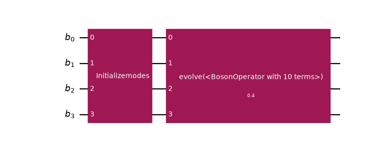
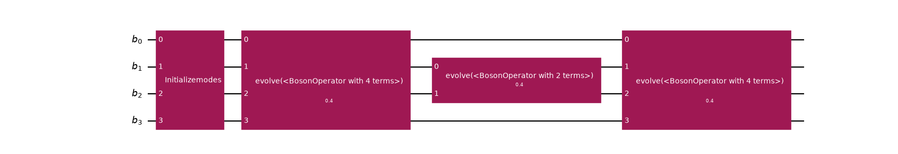

<a id="bose-hubbard-getting-started"></a>

# Simulate Bose-Hubbard dynamics with a choice of encoding

This guide builds a circuit for the **time dynamics of the one-dimensional Bose-Hubbard
model**, from writing down the Hamiltonian to checking the evolved site densities against
an exact reference. What makes the route interesting is a single idea:

> Do not choose a boson-to-qubit encoding when you build the circuit. Build the circuit
> on **bosonic modes**, and let the **transpiler** decide how those modes become qubits.

For bosons, you nearly always need to defer the encoding. A bosonic mode holds
arbitrarily many particles, so its Fock space is infinite-dimensional and no encoding
exists until you first pick a **truncation** $d$ (the number of occupation levels
you keep). In code the truncation is given as the largest occupation a mode can hold,
`max_occupation` $= d - 1$, so a mode that keeps the levels $0, 1, 2$ has
`max_occupation = 2` and $d = 3$.

That makes the truncation a *parameter of the encoding*, not of the physics, and it is a
parameter you want to vary: too small and the answer is wrong, too large and the circuit is
needlessly wide. If you defer the encoding to transpile time, you can sweep the truncation without
changing the circuit, the Hamiltonian, or the grouping.

#### SEE ALSO
The [operators guide](operators.html.md#operators-explanation) for the operator data structure, the
[mappers guide](mappers.html.md#mappers-explanation) for the encodings and the recipe for writing a
custom mapper, and the [transpilation guide](transpilation.html.md#transpilation-explanation) for the transpiler
stages referenced throughout.

## Truncation, and what it costs

When you truncate a mode to $d$ levels, you break the canonical commutator on the highest
retained level <sup>[1](#id3)</sup>, so no encoding is an isomorphism of *algebras*: a bosonic encoding maps states, and
operators acting within the truncated subspace. Two consequences matter for everything that follows:

1. $d$ must bound the occupation reachable by the dynamics, not merely that of the
   initial state.
2. Mapping does not commute with normal ordering, so decide once whether your Hamiltonian is
   defined in normal-ordered form, and stay consistent.

The [mappers guide](mappers.html.md#truncation-explanation) derives the defect and shows both consequences
on running code.

## 1. The Hamiltonian

The Bose-Hubbard model on a lattice with bonds $\langle i j \rangle$ is

$$
H = -t \sum_{\langle i j \rangle} \left(b^\dagger_i b_j + b^\dagger_j b_i\right)
    + \frac{U}{2} \sum_i n_i (n_i - 1) \, ,
$$

with $n_i = b^\dagger_i b_i$. The interaction counts *pairs* of bosons on a site, so
it requires a site to hold two particles at once. Normal-ordered,
$n_i(n_i-1) = b^\dagger_i b^\dagger_i b_i b_i$, which is the form used in what follows.

The geometry enters only through the edge list, so nothing is specific to a chain:

```pycon
>>> from qiskit_bosons.operators import BosonOperator, ann, cre
>>>
>>> def bose_hubbard(edges, num_sites, tunneling, interaction):
...     """Build the normal-ordered Bose-Hubbard Hamiltonian on an arbitrary lattice."""
...     terms = {}
...     for i, j in edges:
...         terms[(cre(i), ann(j))] = -tunneling
...         terms[(cre(j), ann(i))] = -tunneling
...     for i in range(num_sites):
...         # U/2 * n_i (n_i - 1), already normal-ordered
...         terms[(cre(i), cre(i), ann(i), ann(i))] = 0.5 * interaction
...     return BosonOperator.from_dict(terms)
>>>
>>> num_sites = 4
>>> edges = [(i, i + 1) for i in range(num_sites - 1)]
>>> hamiltonian = bose_hubbard(edges, num_sites, tunneling=1.0, interaction=2.0)
>>> print(f"Number of terms: {len(hamiltonian)}")
Number of terms: 10
```

Two properties are worth checking first. The Hamiltonian must be Hermitian for
$e^{-itH}$ to be unitary, and it conserves the total boson number:

```pycon
>>> hamiltonian.is_hermitian()
True
>>> hamiltonian.conserves_particle_number()
True
```

Now the bosonic question: how many levels does this operator demand?

```pycon
>>> hamiltonian.max_occupation()
2
```

The interaction term applies two creation operators to one mode, so a mode has to hold two
bosons for the term to act at all. That is a **maximum occupation** of 2, which is the number
that [`LevelSpec`](../stubs/qiskit_bosons.mappers.LevelSpec.html.md#qiskit_bosons.mappers.LevelSpec) takes as its `max_occupation`. A mode that keeps
the occupations $0, 1, 2$ has $d = \texttt{max\_occupation} + 1 = 3$ levels, so
`max_occupation >= 2` is the same requirement as $d \geq 3$.

This is a lower bound only: it comes from one application of the operator, and repeated
application over a time evolution can reach further. It rules out cutoffs that are certainly too
small, and step 6 settles, for this model and state, how large the cutoff has to be.
[`mode_occupations()`](../stubs/qiskit_bosons.operators.BosonOperator.html.md#qiskit_bosons.operators.BosonOperator.mode_occupations) reports the bound for each mode
separately, which is what a per-mode cutoff is compared against.

<a id="bose-hubbard-grouping"></a>

## 2. Group before mapping

The evolution is Trotterized, and how the Hamiltonian is partitioned decides what the
synthesis is handed. Two considerations pull in the same direction.

First, a physical one: the individual hopping term $b^\dagger_i b_j$ is **not
Hermitian**. Only the pair $b^\dagger_i b_j + b^\dagger_j b_i$ is. If you evolve under a
single non-Hermitian term, the operation is not unitary, and the mapped operator would carry
complex coefficients that [`PauliEvolutionGate`](https://quantum.cloud.ibm.com/docs/api/qiskit/qiskit.circuit.library.PauliEvolutionGate)
rejects. Each bond’s two hopping terms must therefore stay together.

Second, an efficiency one: all the on-site interaction terms are diagonal in the occupation
basis and mutually commute, so they can share a single group and be synthesized together. The
same holds for the bonds that touch no common site. On a chain, every second bond is such a set:
bonds 0 and 2 act on disjoint pairs of modes, so their hopping terms commute and can share a
group, and bond 1 forms a group of its own. If you group the even and the odd bonds,
you therefore need three groups, where one group per bond needs four. Fewer groups mean fewer factors, and
also a shallower circuit: with the Gray code at `max_occupation = 2` the two-qubit depth is 95
against 139. The lattice decides which bonds can share a group, which is why the partition is
chosen here.

The [`groups`](../stubs/qiskit_bosons.operators.BosonOperator.html.md#qiskit_bosons.operators.BosonOperator.groups) attribute carries that decision
into the circuit: an [`Evolution`](../stubs/qiskit_bosons.circuit.library.Evolution.html.md#qiskit_bosons.circuit.library.Evolution) gate over a grouped
operator decomposes into one sub-evolution per group. The partition is chosen at the
bosonic level, while the lattice structure is still visible, and it survives untouched
through the mapping. The [grouping guide](grouping.html.md#grouping-explanation) covers the checks a
grouping should pass.

```pycon
>>> def group_of(actions, edges):
...     """Assign each term to the even bonds, the odd bonds, or the on-site group."""
...     creations = sorted(mode for action, mode in actions if action)
...     annihilations = sorted(mode for action, mode in actions if not action)
...     if creations == annihilations:
...         return 2  # diagonal: the on-site interaction group
...     bond = tuple(sorted(set(creations) | set(annihilations)))
...     return edges.index(bond) % 2  # bonds 0 and 2 share a group, bond 1 has its own
>>>
>>> hamiltonian.groups = [group_of(actions, edges) for actions, _ in hamiltonian.iter_terms()]
>>> hamiltonian.num_groups()
3
```

Every group must itself be Hermitian, which is what the preceding pairing buys.
[`groups_are_hermitian()`](../stubs/qiskit_bosons.operators.terms.groups_are_hermitian.html.md#qiskit_bosons.operators.terms.groups_are_hermitian) checks all groups in one call:

```pycon
>>> from qiskit_bosons.operators.terms import groups_are_hermitian
>>> groups_are_hermitian(hamiltonian)
[True, True, True]
```

To see what each group holds, separate the groups:

```pycon
>>> for index, group in enumerate(hamiltonian.split_out_groups()):
...     print(f"group {index}: {len(group)} terms, hermitian={group.is_hermitian()}")
group 0: 4 terms, hermitian=True
group 1: 2 terms, hermitian=True
group 2: 4 terms, hermitian=True
```

The even-and-odd grouping is a choice, and the alternative is easy to measure. If you give every bond a group
of its own, you need four groups, and the same circuit then costs more two-qubit depth. The depth is
counted after the circuit is lowered with the Gray code at `max_occupation = 2`, which step 4
explains:

```pycon
>>> from qiskit.transpiler import PassManager
>>> from qiskit_bosons.circuit import BosonicCircuit
>>> from qiskit_bosons.circuit.library import Evolution
>>> from qiskit_bosons.mappers import LevelSpec
>>> from qiskit_bosons.transpiler.presets import generate_preset_occupation_pass_manager
>>>
>>> def two_qubit_depth(operator):
...     """The two-qubit depth of one evolution under ``operator``, lowered with the Gray code."""
...     probe = BosonicCircuit(num_sites)
...     probe.append(Evolution(num_sites, operator, time=0.4), probe.modes)
...     pass_manager = generate_preset_occupation_pass_manager(LevelSpec(2, "gray"))
...     pass_manager.qubit = PassManager()
...     lowered = pass_manager.run(probe.decompose())
...     return lowered.decompose(reps=6).depth(lambda instruction: len(instruction.qubits) == 2)
>>>
>>> per_bond = bose_hubbard(edges, num_sites, tunneling=1.0, interaction=2.0)
>>> per_bond.groups = [
...     len(edges) if sorted(m for a, m in actions if a) == sorted(m for a, m in actions if not a)
...     else edges.index(tuple(sorted({m for _, m in actions})))
...     for actions, _ in per_bond.iter_terms()
... ]
>>> per_bond.num_groups(), two_qubit_depth(per_bond)
(4, 139)
>>> hamiltonian.num_groups(), two_qubit_depth(hamiltonian)
(3, 95)
```

## 3. The bosonic circuit

Note what is absent from the circuit. There is no truncation, no encoding, and
no qubit count. It acts on four bosonic modes:

```pycon
>>> from qiskit_bosons.circuit import BosonicCircuit
>>> from qiskit_bosons.circuit.library import Evolution, InitializeModes
>>>
>>> total_time = 0.4
>>> occupation = [1, 1, 0, 0]  # one boson on each of the first two sites
>>>
>>> circuit = BosonicCircuit(num_sites)
>>> circuit.append(InitializeModes(occupation), circuit.modes)
>>> circuit.append(Evolution(num_sites, hamiltonian, time=total_time), circuit.modes)
>>> dict(circuit.count_ops())
{'InitializeModes': 1, 'Evolution': 1}
```

([`png`](_downloads/63f820686cc490e919510e10c5099f41/bose_hubbard-9.png), [`hires.png`](_downloads/70d248f195c3c0352fc3172ae2cf5c7d/bose_hubbard-9.hires.png), [`pdf`](_downloads/f03275ae39ca6e29c7995eb13965412f/bose_hubbard-9.pdf))



The wires are bosonic modes, not qubits. Note that [`InitializeModes`](../stubs/qiskit_bosons.circuit.library.InitializeModes.html.md#qiskit_bosons.circuit.library.InitializeModes) takes **integers**, not
flags: a mode can hold any number of bosons, so a Fock state is a list of occupation numbers.

A single [`decompose()`](../stubs/qiskit_bosons.circuit.BosonicCircuit.html.md#qiskit_bosons.circuit.BosonicCircuit.decompose) turns the grouping from
[step 2](#bose-hubbard-grouping) into one gate per group:

```pycon
>>> decomposed = circuit.decompose()
>>> dict(decomposed.count_ops())
{'Evolution': 3, 'InitializeModes': 1}
```

([`png`](_downloads/0a231b154e0b2a377c5a5991b0679482/bose_hubbard-11.png), [`hires.png`](_downloads/19eb1c2fa4049515e2340fbee775bfc0/bose_hubbard-11.hires.png), [`pdf`](_downloads/85ae6029601a7e960add3e198a9ec594/bose_hubbard-11.pdf))



The first group holds the bonds on modes 0 and 1 and on modes 2 and 3, so its gate spans all four
modes, and so does the on-site group. The middle bond has a gate of its own on modes 1 and 2.

Skip that decomposition and the grouping is simply ignored. Which method does the splitting is
the `synthesis` of the gate, with
[`BosonicLieTrotter`](../stubs/qiskit_bosons.circuit.library.synthesis.BosonicLieTrotter.html.md#qiskit_bosons.circuit.library.synthesis.BosonicLieTrotter) as the default;
[Synthesize an Evolution gate in bosonic space](bosonic_synthesis.html.md#bosonic-synthesis-explanation) shows the alternatives.

<a id="bose-hubbard-transpile"></a>

## 4. Choose the encoding at transpile time

Here is the payoff. The same circuit is lowered four times, under four different
[`LevelEncoding`](../stubs/qiskit_bosons.mappers.LevelEncoding.html.md#qiskit_bosons.mappers.LevelEncoding) values, by changing one argument. A
[`LevelSpec`](../stubs/qiskit_bosons.mappers.LevelSpec.html.md#qiskit_bosons.mappers.LevelSpec) pairs the encoding with the truncation of every mode,
and the following preset derives the layout, the state preparation, and the operator mapping from that
one spec (see [Describe the truncation with a LevelSpec](mappers.html.md#level-spec-explanation)). A string such as `"gray"` is accepted wherever a
`LevelEncoding` is.

```pycon
>>> from qiskit.transpiler import PassManager
>>> from qiskit_bosons.mappers import LevelEncoding, LevelSpec
>>> from qiskit_bosons.transpiler.presets import generate_preset_occupation_pass_manager
>>>
>>> max_occupation = 2  # the largest occupation per mode, so d = max_occupation + 1 = 3 levels
>>>
>>> encodings = (
...     LevelEncoding.UNARY_PROJECTED,
...     LevelEncoding.UNARY_UNPROJECTED,
...     LevelEncoding.STANDARD_BINARY,
...     LevelEncoding.GRAY,
... )
>>> for encoding in encodings:
...     pass_manager = generate_preset_occupation_pass_manager(
...         LevelSpec(max_occupation, encoding)
...     )
...     pass_manager.qubit = PassManager()  # keep the circuit as the pipeline synthesized it
...     qubit_circuit = pass_manager.run(decomposed)
...     basis = qubit_circuit.decompose(reps=6)
...     two_qubit = basis.depth(lambda instruction: len(instruction.qubits) == 2)
...     print(f"{encoding!s:18s} qubits={qubit_circuit.num_qubits:2d}  2q-depth={two_qubit:4d}")
unary_projected    qubits=12  2q-depth= 645
unary_unprojected  qubits=12  2q-depth= 383
standard_binary    qubits= 8  2q-depth= 218
gray               qubits= 8  2q-depth=  95
```

These numbers contradict a natural guess. The unary encodings use
$d$ qubits per mode against $\lceil \log_2 d \rceil$ for the compact codes, and at
$d = 3$ the compact codes win on both axes at once: fewer qubits and far fewer
entangling gates. The two unary variants differ in the operator they emit, not in their layout:
[`LevelEncoding.UNARY_PROJECTED`](../stubs/qiskit_bosons.mappers.LevelEncoding.html.md#qiskit_bosons.mappers.LevelEncoding.UNARY_PROJECTED) carries a projector on every other qubit of a mode, which
makes it the most expensive of the four to evolve, and [`LevelEncoding.UNARY_UNPROJECTED`](../stubs/qiskit_bosons.mappers.LevelEncoding.html.md#qiskit_bosons.mappers.LevelEncoding.UNARY_UNPROJECTED)
leaves the projectors out and agrees with it on the one-hot subspace. The
[mappers guide](mappers.html.md#unary-variants-explanation) shows the two operators side by side, and
explains why the Gray code beats standard binary (SB) on the hopping terms.

Sawaya et al. report the same ordering <sup>[2](#id4)</sup>:

> though the unary code tends to require more qubits but fewer operations, it is often the
> case that the SB or Gray code is more efficient both in terms of qubit counts and
> operation counts

Their conclusion is that the best code depends on the Hamiltonian and on $d$, which is the
strongest argument for not fixing the choice in the circuit.

#### NOTE
Under a level encoding a mode spans several qubits, so the qubit register is
wider than the mode register. The preset uses [`OccupationB2QLayout`](../stubs/qiskit_bosons.transpiler.passes.OccupationB2QLayout.html.md#qiskit_bosons.transpiler.passes.OccupationB2QLayout), which
derives the register width from the [`LevelSpec`](../stubs/qiskit_bosons.mappers.LevelSpec.html.md#qiskit_bosons.mappers.LevelSpec). The
[transpilation guide](transpilation.html.md#transpilation-explanation) walks through the stages the preset
runs.

<a id="bose-hubbard-verify"></a>

## 5. Verify against exact dynamics

None of the preceding steps establishes that the circuit is right. For that, compare the site
densities $\langle n_m \rangle$ after evolution against an exact reference computed on
the encoded Hamiltonian.

The reference has to be computed in the same truncated space the circuit works in, because
comparing against an untruncated calculation would conflate Trotter error with truncation
error, which are different things and worth separating (see [Truncate the Fock space](mappers.html.md#truncation-explanation)).

```pycon
>>> import numpy as np
>>> from qiskit.quantum_info import SparsePauliOp, Statevector
>>> from scipy.sparse.linalg import expm_multiply
>>> from qiskit_bosons.mappers.library import occupation_encoding
>>>
>>> def sparse_matrix(operator, encoding):
...     """Map a bosonic operator and hand back a sparse qubit matrix."""
...     spec = LevelSpec(max_occupation, encoding).resolve(num_sites)
...     observable = occupation_encoding(operator, spec)
...     return SparsePauliOp.from_sparse_observable(observable).to_matrix(sparse=True)
>>>
>>> def fock_index(occupation, encoding):
...     """The computational basis index encoding a product Fock state."""
...     spec = LevelSpec(max_occupation, encoding).resolve(num_sites)
...     return sum(
...         encoding.level_to_bits(n) << offset for n, offset in zip(occupation, spec.offsets)
...     )
>>>
>>> def densities(state, encoding):
...     """The per-site boson number <n_m> of an encoded state vector."""
...     out = []
...     for mode in range(num_sites):
...         number = BosonOperator.from_dict({(cre(mode), ann(mode)): 1.0})
...         matrix = sparse_matrix(number, encoding)
...         out.append(float((state.conj() @ (matrix @ state)).real))
...     return out
```

With those in hand, the exact evolution in the truncated space:

```pycon
>>> encoding = LevelEncoding.GRAY
>>> num_qubits = LevelSpec(max_occupation, encoding).resolve(num_sites).total_width
>>>
>>> initial = np.zeros(2**num_qubits, dtype=complex)
>>> initial[fock_index(occupation, encoding)] = 1.0
>>>
>>> evolved_exact = expm_multiply(
...     -1j * total_time * sparse_matrix(hamiltonian, encoding), initial
... )
>>> reference = densities(evolved_exact, encoding)
>>> for site, value in enumerate(reference):
...     print(f"site {site}: {value:.6f}")
site 0: 0.993834
site 1: 0.858853
site 2: 0.141309
site 3: 0.006004
```

The bosons spread from the occupied end of the chain towards the empty one, and the two bosons
are conserved:

```pycon
>>> bool(np.isclose(sum(reference), 2.0))
True
```

Now the circuit. Note that the preceding reference was built from `initial` directly, so the
circuit compared against it must contain only the evolution, because the
[`InitializeModes`](../stubs/qiskit_bosons.circuit.library.InitializeModes.html.md#qiskit_bosons.circuit.library.InitializeModes) gate would re-prepare a state that
is already prepared.

```pycon
>>> from qiskit_bosons.circuit.library.synthesis import BosonicLieTrotter
>>>
>>> def trotter_densities(steps, encoding):
...     """Site densities after `steps` first-order Trotter steps of the grouped evolution."""
...     circuit = BosonicCircuit(num_sites)
...     circuit.append(
...         Evolution(
...             num_sites, hamiltonian, time=total_time, synthesis=BosonicLieTrotter(reps=steps)
...         ),
...         circuit.modes,
...     )
...     pass_manager = generate_preset_occupation_pass_manager(
...         LevelSpec(max_occupation, encoding)
...     )
...     qubit_circuit = pass_manager.run(circuit.decompose())
...     # decompose BEFORE evolving: see the warning that follows
...     basis = qubit_circuit.decompose(reps=6)
...     state = np.asarray(Statevector(initial).evolve(basis).data)
...     return densities(state, encoding)
>>>
>>> for steps in (1, 2, 4, 8, 16):
...     error = max(
...         abs(a - b) for a, b in zip(trotter_densities(steps, encoding), reference)
...     )
...     print(f"steps={steps:2d}  max density error = {error:.4f}")
steps= 1  max density error = 0.0843
steps= 2  max density error = 0.0389
steps= 4  max density error = 0.0183
steps= 8  max density error = 0.0088
steps=16  max density error = 0.0043
```

The error halves as the step count doubles, which is the $O(t^2/\text{steps})$ signature of
a first-order product formula. That is the evidence that the discrepancy is Trotter error and
the encoding is faithful.

#### IMPORTANT
The repetitions come from the `synthesis` of the gate, which Trotterizes in bosonic space
where the grouping still exists: each step applies every group once, and the steps follow one
another. That is different from handing a [`LieTrotter`](https://quantum.cloud.ibm.com/docs/api/qiskit/qiskit.synthesis.LieTrotter) with
`reps > 1` to the qubit-level synthesis plugin. There, each group is already its own
[`PauliEvolutionGate`](https://quantum.cloud.ibm.com/docs/api/qiskit/qiskit.circuit.library.PauliEvolutionGate), so the formula only subdivides the terms
within a group and never interleaves the groups. The groups do not mutually commute, so that
leaves a single outer Trotter step whose error does not shrink however large `reps` is.
[Synthesize an Evolution gate in bosonic space](bosonic_synthesis.html.md#bosonic-synthesis-explanation) compares the two and covers higher orders.

#### WARNING
The preceding [`decompose()`](https://quantum.cloud.ibm.com/docs/api/qiskit/qiskit.circuit.QuantumCircuit#decompose) call is essential.
[`evolve()`](https://quantum.cloud.ibm.com/docs/api/qiskit/qiskit.quantum_info.Statevector#evolve) uses a
[`PauliEvolutionGate`](https://quantum.cloud.ibm.com/docs/api/qiskit/qiskit.circuit.library.PauliEvolutionGate)’s exact definition and bypasses the
product formula entirely. If you verify against an un-decomposed circuit, you see near-perfect
agreement even for a deliberately wrong synthesis. The un-decomposed circuit also forces a
dense $2^{n} \times 2^{n}$ operator to be built, whereas a decomposed circuit applies
gates one at a time. Other simulators can treat the gate differently, so this check depends on
the simulator, whereas hardware always needs the decomposed form.

Finally, the central check: the physics must not depend on which encoding was chosen.

```pycon
>>> def exact_densities(encoding):
...     """Exact truncated-space densities, computed under a given encoding."""
...     width = LevelSpec(max_occupation, encoding).resolve(num_sites).total_width
...     start = np.zeros(2**width, dtype=complex)
...     start[fock_index(occupation, encoding)] = 1.0
...     evolved = expm_multiply(
...         -1j * total_time * sparse_matrix(hamiltonian, encoding), start
...     )
...     return densities(evolved, encoding)
>>>
>>> all(
...     bool(np.allclose(exact_densities(name), reference, atol=1e-10))
...     for name in encodings
... )
True
```

The qubit counts, Pauli structures, and circuit depths all differ, and the physics agrees to ten
decimal places. The encoding is an implementation choice, which is why it belongs to the
transpiler. The two unary variants agree here because the simulated state stays on the one-hot
subspace; away from it they would differ.

## 6. Truncation is a convergence parameter

The final step is specific to bosons. Everything so far had fixed
`max_occupation = 2`, that is $d = 3$. However, the truncation is not a free choice: it is a
**convergence parameter**, and an answer is only trustworthy after it stops moving (see
[Truncate the Fock space](mappers.html.md#truncation-explanation)).

The circuit carries no truncation, so the circuit itself does not change when the cutoff does:
only the transpilation is repeated. What changes is the size of what comes out, and a sweep is only
as cheap as it is here because the system is tiny. The following reference is an exact classical
simulation of the truncated dynamics, which is possible for four sites and grows exponentially with
the number of qubits. For a problem beyond that reach there is no exact reference to compare
against, and the convergence has to be judged by other means.

```pycon
>>> def densities_at_cutoff(max_occ, encoding=LevelEncoding.GRAY):
...     """Exact truncated-space densities at a given cutoff."""
...     spec = LevelSpec(max_occ, encoding).resolve(num_sites)
...
...     start = np.zeros(2**spec.total_width, dtype=complex)
...     start[
...         sum(encoding.level_to_bits(n) << offset for n, offset in zip(occupation, spec.offsets))
...     ] = 1.0
...
...     def matrix(operator):
...         observable = occupation_encoding(operator, spec)
...         return SparsePauliOp.from_sparse_observable(observable).to_matrix(sparse=True)
...
...     evolved = expm_multiply(-1j * total_time * matrix(hamiltonian), start)
...     out = []
...     for mode in range(num_sites):
...         number = BosonOperator.from_dict({(cre(mode), ann(mode)): 1.0})
...         out.append(float((evolved.conj() @ (matrix(number) @ evolved)).real))
...     return out
>>>
>>> previous = None
>>> for max_occ in (1, 2, 3, 4):
...     current = densities_at_cutoff(max_occ)
...     # Report the drift bucketed rather than to full precision: after it reaches machine
...     # epsilon, the exact digits are arithmetic noise and vary between BLAS builds.
...     if previous is None:
...         drift = "--"
...     else:
...         gap = max(abs(a - b) for a, b in zip(current, previous))
...         drift = f"{gap:.0e}" if gap > 1e-12 else "< 1e-12"
...     print(f"d={max_occ + 1}  "
...           + " ".join(f"{x:.6f}" for x in current)
...           + f"   drift={drift}")
...     previous = current
d=2  0.993986 0.858173 0.141827 0.006014   drift=--
d=3  0.993834 0.858853 0.141309 0.006004   drift=7e-04
d=4  0.993834 0.858853 0.141309 0.006004   drift=< 1e-12
d=5  0.993834 0.858853 0.141309 0.006004   drift=< 1e-12
```

At `max_occupation = 1` ($d = 2$) each site holds at most one
boson, so the interaction term, which needs two on a site, cannot act at all, and the densities are
off by about $7 \times 10^{-4}$. When you add the third level, the result captures the interaction, and from `max_occupation = 3` on
the result is stationary to machine precision: converged.

The reason that it stops at `max_occupation = 2` is particle number. The Hamiltonian conserves the
number of bosons, and this state holds two, so no site can ever hold more than two, whatever the
evolution time and whether the interaction is repulsive or attractive. If you evolve to
$t = 6$ instead of $t = 0.4$, or flip the sign of $U$, the densities at
`max_occupation = 2` and higher stay unchanged to $10^{-13}$.

What does push the requirement up is the **number of bosons**. Three bosons on the same chain change
by about $2 \times 10^{-3}$ between `max_occupation = 2` and `3` after the same short
evolution, and by about $0.3$ after $t = 6$. That is a statement about this model and a
conserved quantity, and it is a bound only for operators that conserve the particle number; it is
not a general rule, so the cutoff has to be swept, not guessed.

The sweep has a price on the circuit side too, which is what the exact reference does not show.
The same bosonic circuit, lowered with the Gray code at each cutoff:

```pycon
>>> for max_occ in (1, 2, 3, 4):
...     pass_manager = generate_preset_occupation_pass_manager(
...         LevelSpec(max_occ, LevelEncoding.GRAY)
...     )
...     pass_manager.qubit = PassManager()
...     lowered = pass_manager.run(decomposed)
...     depth = lowered.decompose(reps=6).depth(lambda instruction: len(instruction.qubits) == 2)
...     print(f"d={max_occ + 1}  qubits={lowered.num_qubits:2d}  2q-depth={depth:4d}")
d=2  qubits= 4  2q-depth=   8
d=3  qubits= 8  2q-depth=  95
d=4  qubits= 8  2q-depth= 217
d=5  qubits=12  2q-depth=1176
```

Each extra level costs depth, and the qubit count jumps whenever $d$ passes a power of two.
When you converge in $d$, you therefore trade accuracy against circuit size, so the sweep is
more than a numerical check.

Note also that $d = 2$ being nearly right is a coincidence of the observable:
the site *densities* barely move, while the underlying state is qualitatively wrong (it has
no doubly-occupied component). If one observable converges, that does not show
that another has converged.

## What to take away

- **The encoding is a transpiler concern.** The bosonic circuit in
  [step 3](#bose-hubbard-transpile) mentions no truncation, no encoding, and no qubit
  count. Four encodings then lowered it to four different circuits, all reproducing the
  same physics. Nothing upstream of the transpiler had to change.
- **For bosons this is not merely convenient.** The truncation is a convergence parameter
  that has to be swept, and it lives inside the encoding. A circuit built against a fixed
  encoding would have to be rebuilt for every value of $d$.
- **Group before mapping, and group for Hermiticity.** A single hopping term is not
  Hermitian and cannot be exponentiated; the bond pair on the hand is Hermitian and therefore
  can be exponentiated. Decide the partition at the
  bosonic level, where the lattice is still visible. That is physically necessary, and the
  [`groups`](../stubs/qiskit_bosons.operators.BosonOperator.html.md#qiskit_bosons.operators.BosonOperator.groups) attribute exists to carry the decision
  forward.
- **Do not assume the low-weight encoding is the cheap one.** At $d = 3$ the compact
  codes beat both unary variants on qubits and gates simultaneously, and the projected
  variant is the costliest of all. Measure; the crossover is $d$-dependent.
- **Truncation breaks the algebra, in a quantifiable way.** Only on the top retained level,
  by $d$. That is also why mapping does not commute with normal ordering.

## Next steps

Two directions extend this example. If you replace the chain’s edge list with the bonds of a square
lattice, you need no other change, because the `bose_hubbard` function defined earlier is already
geometry-agnostic. A custom encoding of your own (a block-unary code, for example, which
interpolates between unary and compact) also plugs in through the same
`MapperFnEvolutionSynthesis` seam the preset uses.

- [Design principles of operator representations](operators.html.md#operators-explanation) explains the operator data structure behind the Hamiltonian.
- [Map operator representations](mappers.html.md#mappers-explanation) covers the encodings and writing a mapper of your own.
- [Transpile bosonic circuits](transpilation.html.md#transpilation-explanation) walks through the stages the preset runs.
- [Synthesize an Evolution gate in bosonic space](bosonic_synthesis.html.md#bosonic-synthesis-explanation) shows how to reduce the Trotter error in bosonic space.

#### IMPORTANT
Every depth reported is on an abstract, fully connected register. Mapping to real
hardware connectivity is a separate stage, and an occupation encoding’s per-mode qubit
blocks give a router rather different structure to work with than one qubit per mode.

* <a id='id3'>**[1]**</a> R. Somma, G. Ortiz, E. Knill, and J. Gubernatis, Quantum Simulations of Physics Problems (2003), [arXiv:quant-ph/0304063](https://arxiv.org/abs/quant-ph/0304063), Sec. 4, Eq. 22.
* <a id='id4'>**[2]**</a> N. P. D. Sawaya, T. Menke, T. H. Kyaw, S. Johri, A. Aspuru-Guzik, and G. G. Guerreschi, Resource-efficient digital quantum simulation of d-level systems for photonic, vibrational, and spin-s Hamiltonians, npj Quantum Information 6, 49 (2020), [arXiv:1909.12847](https://arxiv.org/abs/1909.12847).
