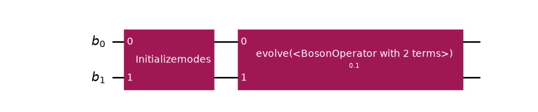
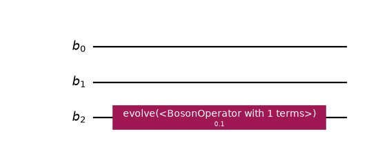
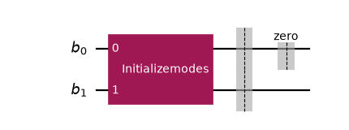
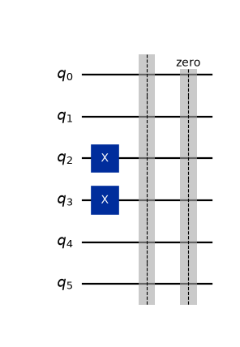

<a id="bosonic-circuit-explanation"></a>

# Work with bosonic circuits

A [`BosonicCircuit`](../stubs/qiskit_bosons.circuit.BosonicCircuit.html.md#qiskit_bosons.circuit.BosonicCircuit) expresses a computation directly on **bosonic
modes**. It carries no truncation, no encoding, and no qubit count: those enter later, during
transpilation, which is how one circuit can be lowered under several encodings and several
truncations without being rebuilt.

It deliberately exposes a reduced API compared to Qiskit’s
[`QuantumCircuit`](https://quantum.cloud.ibm.com/docs/api/qiskit/qiskit.circuit.QuantumCircuit), so that qubit gates cannot be applied to a bosonic mode,
which would not be a well-defined operation. This guide covers the operations that *are* exposed
for assembling larger circuits out of smaller ones.

## Why use bosonic circuits

Consider the traditional workflow for putting the time evolution of a bosonic Hamiltonian onto a
qubit-based architecture:

1. Define the bosonic Hamiltonian, for example $H = -\sum_{ij} b^\dagger_i b_j$.
2. Choose a truncation and an encoding, and map the Hamiltonian to a qubit operator with them.
3. Implement the time evolution in qubit space, by Trotterization or another method.

The second step comes early, and it makes two decisions that are expensive to take back. The
truncation fixes how many levels each mode keeps, and the encoding fixes how many qubits that costs,
so both are fixed in the qubit operator before anything else has been done with the circuit. To
look at the same physics under another cutoff or another encoding, you map the Hamiltonian again
and build the circuit again. What the mapping discards, as well, is the bosonic structure: which
terms belong together, and that the terms of a hopping pair are each other’s adjoint.

A [`BosonicCircuit`](../stubs/qiskit_bosons.circuit.BosonicCircuit.html.md#qiskit_bosons.circuit.BosonicCircuit) moves those decisions to the end:

1. Define the bosonic Hamiltonian.
2. Express the time evolution directly on bosonic modes, with bosonic gates.
3. Choose the truncation and the encoding as part of the transpilation.

The circuit describes *what* computation to perform, and transpilation decides *how* to put it on
qubits. The same circuit is then lowered at every cutoff and under every encoding, and the
grouping of the operator is still there for the passes that can use it. The next sections show
how such a circuit is assembled; [Transpile bosonic circuits](transpilation.html.md#transpilation-explanation) shows it being lowered.

## Generic mode indexing

The [`operators`](../pydoc/qiskit_bosons.operators.html.md#module-qiskit_bosons.operators) module and the circuit share one convention for modes. A mode
is only an index that labels a bosonic degree of freedom, and it carries no meaning of its own. You
can therefore evolve any operator that implements the [`OperatorTrait`](../stubs/qiskit_bosons.operators.OperatorTrait.html.md#qiskit_bosons.operators.OperatorTrait) protocol, whatever it
represents, and the circuit never needs to know what mode `2` stands for. The same holds for the
size of a mode: a circuit has no occupation cutoff, so nothing here says how many levels a mode
has.

## Append gates

Gates are appended onto modes. Only [`BosonicGate`](../stubs/qiskit_bosons.circuit.BosonicGate.html.md#qiskit_bosons.circuit.BosonicGate) instances are
accepted:

```pycon
>>> from qiskit_bosons.circuit import BosonicCircuit
>>> from qiskit_bosons.circuit.library import Evolution, InitializeModes
>>> from qiskit_bosons.operators import BosonOperator, ann, cre
>>>
>>> hopping = BosonOperator.from_dict({(cre(0), ann(1)): -1.0, (cre(1), ann(0)): -1.0})
>>> hopping.groups = [0] * len(hopping)  # the pair is Hermitian, its terms alone are not
>>>
>>> prepare = BosonicCircuit(2)
>>> prepare.append(InitializeModes([2, 0]), prepare.modes)
>>> step = BosonicCircuit(2)
>>> step.append(Evolution(2, hopping, time=0.1), step.modes)
```

Anything else is refused, and the error names the offending type:

```pycon
>>> from qiskit.circuit.library import HGate
>>> try:
...     prepare.append(HGate(), [0])
... except ValueError as error:
...     print(error)
Unsupported instruction type: <class '...HGate'>
```

## Compose circuits

[`compose()`](../stubs/qiskit_bosons.circuit.BosonicCircuit.html.md#qiskit_bosons.circuit.BosonicCircuit.compose) places the instructions of one circuit onto
another. They are **inlined**, not wrapped into a single gate, so the result is an ordinary
circuit that you can keep decomposing and transpiling.

```pycon
>>> program = prepare.compose(step)
>>> program.draw("mpl", fold=-1)
<Figure size ... with 1 Axes>
```

([`png`](_downloads/79564271ec7e02f69d7225eb17a40b1e/circuit-3.png), [`hires.png`](_downloads/a87b0986e371500adf3e1dd3a51c49e8/circuit-3.hires.png), [`pdf`](_downloads/7f17e3c00ad4fc5c51df7fc7d21c0393/circuit-3.pdf))



By default a new circuit is returned and both operands are left alone. Pass `inplace=True` to
modify the first one instead, and `front=True` to put the operand *before* the existing
instructions:

```pycon
>>> step.compose(prepare, front=True)._inner.data == program._inner.data
True
```

A narrower circuit can be placed onto a chosen subset of the modes:

```pycon
>>> single = BosonicCircuit(1)
>>> single.append(Evolution(1, BosonOperator.from_dict({(cre(0), ann(0)): 1.0}), 0.1), single.modes)
>>> wide = BosonicCircuit(3).compose(single, [2])
>>> wide.draw("mpl", fold=-1)
<Figure size ... with 1 Axes>
```

([`png`](_downloads/46e8955a8679f469eb6734a0a0b81c9d/circuit-5.png), [`hires.png`](_downloads/10c766c3435d9178daa753d574e47f93/circuit-5.hires.png), [`pdf`](_downloads/796b9446e0baccc6000ffc0014b287cc/circuit-5.pdf))



Only another [`BosonicCircuit`](../stubs/qiskit_bosons.circuit.BosonicCircuit.html.md#qiskit_bosons.circuit.BosonicCircuit) is accepted as the operand, because
Qiskit’s own `compose` would inline qubit gates and bypass the check that `append`
enforces.

## Repeat a circuit

[`repeat()`](../stubs/qiskit_bosons.circuit.BosonicCircuit.html.md#qiskit_bosons.circuit.BosonicCircuit.repeat) repeats a circuit end to end. The repetitions
are **flattened**: the result holds the instructions `reps` times in sequence rather than one
gate wrapping the circuit. Therefore, the operation counts scale with `reps`, and `decompose` acts on
the repeated body instead of removing one repetition.

```pycon
>>> len(step.repeat(0)._inner.data)  # zero repetitions is the identity
0
>>> step.repeat(5).draw("mpl", fold=-1)
<Figure size ... with 1 Axes>
```

([`png`](_downloads/dbefd6e46f2f5a4f9fb6e4cba8d4bfe5/circuit-6.png), [`hires.png`](_downloads/ab9a485ad2af46a6f62a623471f9ea26/circuit-6.hires.png), [`pdf`](_downloads/57d6fbf25cefa55154441c7bc079888f/circuit-6.pdf))


This is the circuit-level way to Trotterize: evolve for a short time, and repeat. See
[Synthesize an Evolution gate in bosonic space](bosonic_synthesis.html.md#bosonic-synthesis-explanation) for the alternative of choosing a product formula on the gate
itself, and why the two are different things that happen to share the word “repetitions”.

## Separate steps with barriers

A **barrier** marks a synchronization point that optimization passes do not fuse gates across.
[`barrier()`](../stubs/qiskit_bosons.circuit.BosonicCircuit.html.md#qiskit_bosons.circuit.BosonicCircuit.barrier) places one on all modes, or on the modes you
name:

```pycon
>>> program = BosonicCircuit(2)
>>> program.append(InitializeModes([2, 0]), program.modes)
>>> program.barrier()
>>> program.barrier(program.modes[0], label="zero")
>>> program.draw("mpl", fold=-1)
<Figure size ... with 1 Axes>
```

([`png`](_downloads/0894e7d066561419daa14cc8570ab5a0/circuit-7.png), [`hires.png`](_downloads/dad39a7d98d3772b0f9fbcac06c6514c/circuit-7.hires.png), [`pdf`](_downloads/71fefd5cfc89469bbd59826daf391f73/circuit-7.pdf))



`repeat(..., insert_barriers=True)` puts one between consecutive repetitions, and none after the
last:

```pycon
>>> step.repeat(3, insert_barriers=True).draw("mpl", fold=-1)
<Figure size ... with 1 Axes>
```

([`png`](_downloads/bc670a1891765047c27e74daddb3aa2f/circuit-8.png), [`hires.png`](_downloads/c24d73bef560023f5e4a0e6daa6ba1eb/circuit-8.hires.png), [`pdf`](_downloads/f8012ec68dabbed702237ba0eb0862b7/circuit-8.pdf))


### Barriers and the encoding

An encoding needs several qubits per mode, so the register of modes and the register of qubits
differ in size, and a layout relates *whole registers*. A mode therefore has no qubits of its own
to narrow a barrier to. During the boson-to-qubit synthesis a barrier is mapped onto **every qubit
of each register it touched**, which is correct under any layout:

```pycon
>>> from qiskit_bosons.mappers import LevelSpec
>>> from qiskit_bosons.transpiler.presets import generate_preset_occupation_pass_manager
>>> lowered = generate_preset_occupation_pass_manager(LevelSpec(2, "unary_projected")).run(program)
>>> lowered.draw("mpl", fold=-1)
<Figure size ... with 1 Axes>
```

([`png`](_downloads/f4abeb78f9205e8ce368d83fb0229a16/circuit-9.png), [`hires.png`](_downloads/74eb315eb0ccf825e0be82f3af7a9c17/circuit-9.hires.png), [`pdf`](_downloads/1908f627af51053a797f55e3b5e77418/circuit-9.pdf))



## Read out a bosonic circuit

A [`BosonicCircuit`](../stubs/qiskit_bosons.circuit.BosonicCircuit.html.md#qiskit_bosons.circuit.BosonicCircuit) has no `measure` or `measure_all`. What a
measured bit means depends on the encoding. Under a unary encoding the occupation of a mode is
spread over several qubits and has to be read from a pattern of bits, and under a compact one it
is a binary number, so a measurement that names a mode would have to know the encoding, which a
bosonic circuit deliberately does not. Measure the transpiled
[`QuantumCircuit`](https://quantum.cloud.ibm.com/docs/api/qiskit/qiskit.circuit.QuantumCircuit) instead, and decode the bitstrings with
[`LevelEncoding.level_to_bits()`](../stubs/qiskit_bosons.mappers.LevelEncoding.html.md#qiskit_bosons.mappers.LevelEncoding.level_to_bits) and the offsets of the [`LevelSpec`](../stubs/qiskit_bosons.mappers.LevelSpec.html.md#qiskit_bosons.mappers.LevelSpec) that you lowered
with. [Simulate Bose-Hubbard dynamics with a choice of encoding](bose_hubbard.html.md#bose-hubbard-getting-started) does this for a complete model.

```pycon
>>> hasattr(BosonicCircuit, "measure_all")
False
```

## Next steps

- [Transpile bosonic circuits](transpilation.html.md#transpilation-explanation) explains how a bosonic circuit becomes a qubit circuit,
  stage by stage.
- [Rotate bosonic modes](mode_rotation.html.md#mode-rotation-explanation) covers the gate that mixes modes and conserves the boson number.
- [Synthesize an Evolution gate in bosonic space](bosonic_synthesis.html.md#bosonic-synthesis-explanation) shows how to Trotterize an evolution in bosonic space.
- [Design principles of operator representations](operators.html.md#operators-explanation) explains the operators that the gates carry.
