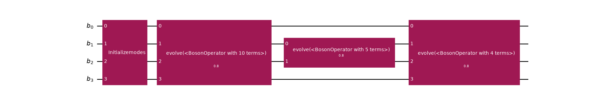
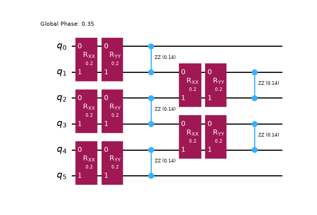

<a id="spin-models-getting-started"></a>

# Simulate spin chains with hard-core bosons

Spin-1/2 chains such as the transverse-field Ising model and the Heisenberg model are native to
qubits, so it can seem odd to describe them with bosons. The reason to do so is control. When you
pass a qubit operator to Qiskit’s [`PauliEvolutionGate`](https://quantum.cloud.ibm.com/docs/api/qiskit/qiskit.circuit.library.PauliEvolutionGate), the product
formula visits the terms in the order they are stored, and that order is fixed when the operator is
constructed. A [`BosonOperator`](../stubs/qiskit_bosons.operators.BosonOperator.html.md#qiskit_bosons.operators.BosonOperator) instead tags every term with a
**group index**, and the product formula visits the groups (see [Group operator terms: use the operator structure](grouping.html.md#grouping-explanation)). You
can change which terms evolve together, and in which order, without rebuilding the operator, and you
can choose the product formula independently of both.

This guide uses group indices to simulate the dynamics of a generic XYZ chain and two of its
special cases.
It follows the route of [Simulate Bose-Hubbard dynamics with a choice of encoding](bose_hubbard.html.md#bose-hubbard-getting-started).

## The generic XYZ chain

The model is a chain of $N$ spin-1/2 particles with anisotropic nearest-neighbor couplings and
a field along each axis:

$$
H = \sum_{i=0}^{N-2} \left(J_x X_i X_{i+1} + J_y Y_i Y_{i+1} + J_z Z_i Z_{i+1}\right)
    + \sum_{i=0}^{N-1} \left(h_x X_i + h_y Y_i + h_z Z_i\right) \, .
$$

The rest of this guide isolates two special cases of it:

| Model                            | Couplings       | Fields          |
|----------------------------------|-----------------|-----------------|
| Transverse-field Ising           | $J_x = J_y = 0$ | $h_y = h_z = 0$ |
| XXZ (Heisenberg for $J_z = J_x$) | $J_x = J_y$     | $h_x = h_y = 0$ |

## A spin as a hard-core boson

A bosonic mode truncated to $d = 2$ levels, that is `max_occupation = 1`, holds either no
boson or one. That is a qubit, and the ladder operators become the Pauli operators. Take
$\lvert 0 \rangle$ as the state with $Z = +1$:

| Pauli operator   | Bosonic form                   |
|------------------|--------------------------------|
| $X$              | $b + b^\dagger$                |
| $Y$              | $i \left(b^\dagger - b\right)$ |
| $Z$              | $1 - 2 b^\dagger b$            |

Products on different modes need no ordering, because their operators commute. The three bond terms
are therefore

$$
\begin{align*}
X_i X_j &= b^\dagger_i b_j + b^\dagger_j b_i + b^\dagger_i b^\dagger_j + b_i b_j \, , \\
Y_i Y_j &= b^\dagger_i b_j + b^\dagger_j b_i - b^\dagger_i b^\dagger_j - b_i b_j \, , \\
Z_i Z_j &= \left(1 - 2 n_i\right)\left(1 - 2 n_j\right) \, ,
\end{align*}
$$

with $n = b^\dagger b$. The $X X$ and $Y Y$ terms each consist of a hopping term
and a pair-creation term, and they differ only in the sign of the pair-creation term. If you weight
them with their couplings and add them, you get

$$
J_x X_i X_j + J_y Y_i Y_j = \left(J_x + J_y\right)\left(b^\dagger_i b_j + b^\dagger_j b_i\right)
    + \left(J_x - J_y\right)\left(b^\dagger_i b^\dagger_j + b_i b_j\right) \, .
$$

The pair-creation term breaks the conservation of the boson number, and it is present only when
$J_x \neq J_y$.

#### IMPORTANT
The truncation makes each mode a spin. At `max_occupation = 1`, the term
$b^\dagger b^\dagger$ maps to zero, and $b b^\dagger$ is not
$b^\dagger b + 1$. Write the operators in the form above and do not call
[`normal_ordered()`](../stubs/qiskit_bosons.operators.BosonOperator.html.md#qiskit_bosons.operators.BosonOperator.normal_ordered) on the Hamiltonian. See
[Truncate the Fock space](mappers.html.md#truncation-explanation).

## Build the Hamiltonian

The function below writes the generic chain. Its `group` argument decides which group each term
joins. It receives the kind of term (`"bond"`, `"x"`, `"y"`, or `"z"`) and the bond or site
index, and returns any hashable label. The labels become consecutive group indices in the order of
first use. By default, all bonds share one group and each field axis has its own. The function
drops the constant that the $Z$ terms carry, because it only adds a global phase.

```pycon
>>> import numpy as np
>>> from qiskit.quantum_info import SparseObservable
>>> from qiskit_bosons.mappers import LevelSpec
>>> from qiskit_bosons.mappers.library import occupation_encoding
>>> from qiskit_bosons.operators import BosonOperator, ann, cre
>>>
>>> def xyz_chain(num_sites, couplings, fields=(0.0, 0.0, 0.0), group=None):
...     """The XYZ chain in hard-core boson form, with a group label for every term."""
...     jx, jy, jz = couplings
...     hx, hy, hz = fields
...     group = group or (lambda kind, index: kind)
...     labelled = []
...     for left in range(num_sites - 1):
...         right, label = left + 1, group("bond", left)
...         if jx + jy:  # hopping
...             labelled.append(([cre(left), ann(right)], jx + jy, label))
...             labelled.append(([cre(right), ann(left)], jx + jy, label))
...         if jx - jy:  # pair creation and annihilation
...             labelled.append(([cre(left), cre(right)], jx - jy, label))
...             labelled.append(([ann(left), ann(right)], jx - jy, label))
...         if jz:  # (1 - 2 n_i)(1 - 2 n_j), without its constant
...             labelled.append(([cre(left), ann(left), cre(right), ann(right)], 4 * jz, label))
...             labelled.append(([cre(left), ann(left)], -2 * jz, label))
...             labelled.append(([cre(right), ann(right)], -2 * jz, label))
...     for site in range(num_sites):
...         if hx:
...             label = group("x", site)
...             labelled += [([cre(site)], hx, label), ([ann(site)], hx, label)]
...         if hy:
...             label = group("y", site)
...             labelled += [([cre(site)], 1j * hy, label), ([ann(site)], -1j * hy, label)]
...         if hz:
...             labelled.append(([cre(site), ann(site)], -2 * hz, group("z", site)))
...     labels = list(dict.fromkeys(label for _, _, label in labelled))
...     return BosonOperator.from_terms_with_groups(
...         [(actions, coeff, labels.index(label)) for actions, coeff, label in labelled]
...     )
```

To check it, compare the mapped operator with the Pauli form of the same chain, which is also a
[`SparseObservable`](https://quantum.cloud.ibm.com/docs/api/qiskit/qiskit.quantum_info.SparseObservable). A single cutoff leaves the number of modes open, so
[`LevelSpec.resolve()`](../stubs/qiskit_bosons.mappers.LevelSpec.html.md#qiskit_bosons.mappers.LevelSpec.resolve) fixes it. At two levels per mode, the `gray` and `standard_binary`
encodings use one qubit per mode.

```pycon
>>> def pauli_chain(num_sites, couplings, fields=(0.0, 0.0, 0.0)):
...     """The same chain as a SparseObservable of Pauli terms."""
...     terms = []
...     for left in range(num_sites - 1):
...         terms += [(axis * 2, [left, left + 1], j) for axis, j in zip("XYZ", couplings) if j]
...     for site in range(num_sites):
...         terms += [(axis, [site], h) for axis, h in zip("XYZ", fields) if h]
...     return SparseObservable.from_sparse_list(terms, num_sites)
>>>
>>> num_sites = 4
>>> spec = LevelSpec(1, "gray").resolve(num_sites)
>>> couplings, fields = (1.0, 0.6, 0.3), (0.4, 0.2, 0.5)
>>> mapped = occupation_encoding(xyz_chain(num_sites, couplings, fields), spec)
>>> difference = (mapped.as_paulis() - pauli_chain(num_sites, couplings, fields)).simplify()
>>> # only the constant that was dropped is left, and it has no Pauli factor
>>> len(difference.bit_terms)
0
```

#### NOTE
[`as_paulis()`](https://quantum.cloud.ibm.com/docs/api/qiskit/qiskit.quantum_info.SparseObservable#as_paulis) expands every projector of the
mapped operator into two Pauli terms, so a diagonal term over `w` qubits becomes `2**w`
terms. That is harmless for a bond of two qubits. See the note in [Map operator representations](mappers.html.md#mappers-explanation)
before expanding a larger mapped operator.

## Isolate the special cases

Each special case is one call. The transverse-field Ising chain has only $Z Z$ couplings and
an $X$ field, and the default grouping gives it one group for the couplings and one for the
field:

```pycon
>>> ising = xyz_chain(num_sites, couplings=(0.0, 0.0, -1.0), fields=(-0.7, 0.0, 0.0))
>>> len(ising), ising.num_groups()
(17, 2)
```

The terms within each group commute, so each group can be evolved without error on its own. Only
the non-commutation between the two groups contributes to the Trotter error.

The XXZ chain has equal $X X$ and $Y Y$ couplings, so its pair-creation term vanishes
and the boson number is conserved. It is the hard-core Bose-Hubbard model with a nearest-neighbor
interaction. The Heisenberg chain is the isotropic case $J_z = J_x$. Build the XXZ chain with
a field along $Z$, and a Heisenberg chain without a field:

```pycon
>>> xxz = xyz_chain(num_sites, couplings=(1.0, 1.0, 0.7), fields=(0.0, 0.0, 0.4))
>>> heisenberg = xyz_chain(num_sites, couplings=(1.0, 1.0, 1.0))
>>> xxz.num_groups(), heisenberg.num_groups()
(2, 1)
```

With the default grouping, the XXZ chain has one group for all bonds and one for the field. That is
too coarse. Neighboring bonds do not commute, so the bond group cannot be evolved as one block
without error, and the qubit-level product formula has to split it. The next section chooses groups
that can.

## Choose the groups

A product formula either keeps a group whole or subdivides it at the qubit level. The best groups
are therefore sets of terms that commute, because evolving such a group whole costs no Trotter
error. In the XXZ chain, the terms on one bond commute with each other, and so do the terms on two
bonds that share no site. The bonds fall into two layers, the even bonds
$(0,1), (2,3), \ldots$ and the odd bonds $(1,2), (3,4), \ldots$, and only the two layers
fail to commute. This is the brickwork decomposition. In bosonic space it takes one function, which
labels each bond by its parity and each field axis by its name:

```pycon
>>> def brickwork(kind, index):
...     return index % 2 if kind == "bond" else kind  # bonds by parity, one group per field axis
>>>
>>> couplings, fields = (1.0, 1.0, 0.7), (0.0, 0.0, 0.4)
>>> xxz = xyz_chain(num_sites, couplings, fields, group=brickwork)
>>> xxz.num_groups()
3
```

The three groups are the even bonds, the odd bonds, and the field. A group must be Hermitian on its
own, because a product formula evolves it separately. Check this with
[`groups_are_hermitian()`](../stubs/qiskit_bosons.operators.terms.groups_are_hermitian.html.md#qiskit_bosons.operators.terms.groups_are_hermitian):

```pycon
>>> from qiskit_bosons.operators.terms import groups_are_hermitian
>>> all(groups_are_hermitian(xxz))
True
```

## Evolve in time

To measure an error, you need a reference. Start from the Néel state, in which every other site is
occupied, and evolve it exactly under the Pauli form of the chain:

```pycon
>>> from qiskit.circuit.library import PauliEvolutionGate
>>> from qiskit.quantum_info import Statevector
>>>
>>> total_time = 0.8
>>> hamiltonian = pauli_chain(num_sites, couplings, fields)
>>> neel = Statevector.from_label("1010")
>>> # a Statevector applies the gate as the exact exponential of the whole operator
>>> exact = neel.evolve(PauliEvolutionGate(hamiltonian, time=total_time)).data
```

The Néel state is the bosonic state with the occupations `[0, 1, 0, 1]`, because the occupied
level is $\lvert 1 \rangle$.

The circuit has one [`Evolution`](../stubs/qiskit_bosons.circuit.library.Evolution.html.md#qiskit_bosons.circuit.library.Evolution) gate. Its `synthesis`
argument sets the product formula, which acts on the groups. To lower the circuit to qubits, you
need a mapper function, which receives an operator and the number of qubits.
`occupation_mapper` is the occupation encoding with the `spec` of this chain.
`expanded_mapper` wraps it in [`expand_projectors()`](../stubs/qiskit_bosons.transpiler.passes.synthesis.expand_projectors.html.md#qiskit_bosons.transpiler.passes.synthesis.expand_projectors), which a later section explains, and
then in [`group_wise()`](../stubs/qiskit_bosons.transpiler.passes.synthesis.group_wise.html.md#qiskit_bosons.transpiler.passes.synthesis.group_wise), which keeps the terms of each group together. The helper `lowering`
builds the preset pipeline around the mapper function that you pass, and `error` measures the
final state of a lowered circuit against the reference:

```pycon
>>> from qiskit_bosons.circuit import BosonicCircuit
>>> from qiskit_bosons.circuit.library import Evolution, InitializeModes
>>> from qiskit_bosons.circuit.library.synthesis import BosonicLieTrotter, BosonicSuzukiTrotter
>>> from qiskit_bosons.transpiler.passes import B2BSynthesis, expand_projectors, group_wise
>>> from qiskit_bosons.transpiler.presets import generate_preset_occupation_pass_manager
>>>
>>> occupation_mapper = lambda operator, n: occupation_encoding(operator, spec, n)
>>>
>>> # expand inside group_wise: the other order merges terms across the groups
>>> expanded_mapper = group_wise(expand_projectors(occupation_mapper))
>>>
>>> basis = ["rz", "sx", "x", "cx"]
>>>
>>> def lowering(mapper_fn, formula=None, spec=spec):
...     """Boson-to-qubit stages, then Qiskit's transpiler into a fixed basis.
...
...     A ``formula`` replaces the optimization stage with a pass that applies it to every
...     ``Evolution`` gate, whatever synthesis the gate carries.
...     """
...     pm = generate_preset_occupation_pass_manager(
...         spec, optimization_level=0, basis_gates=basis
...     )
...     pm.synthesis.methods["Evolution"].mapper_fn = mapper_fn
...     if formula is not None:
...         pm.optimization = B2BSynthesis({"Evolution": formula})
...     return pm
>>>
>>> def error(circuit):
...     """Distance between the final state of a qubit circuit and the exact state."""
...     state = Statevector(circuit).data
...     phase = np.vdot(exact, state)  # the dropped constant is a global phase
...     return float(np.max(np.abs(state * abs(phase) / phase - exact)))
```

Before you lower a circuit, look at what the product formula acts on. When you decompose the
circuit, the default first-order formula replaces the gate with one gate per group:

```pycon
>>> circuit = BosonicCircuit(num_sites)
>>> circuit.append(InitializeModes([0, 1, 0, 1]), circuit.modes)
>>> circuit.append(Evolution(num_sites, xxz, time=total_time), circuit.modes)
>>> decomposed = circuit.decompose()
>>> dict(decomposed.count_ops())
{'Evolution': 3, 'InitializeModes': 1}
```

([`png`](_downloads/391537a3902ed6950e6fbbef7f0ec66f/spin_models-10.png), [`hires.png`](_downloads/05528a063b3accbda9b210f0dc2937a1/spin_models-10.hires.png), [`pdf`](_downloads/3101acf61897e004f202b3dde216d125/spin_models-10.pdf))



The wires are bosonic modes, and the gates follow the order of the group indices: the even bonds,
then the odd bonds, then the field. When you lower this circuit to qubits, each group stays whole,
as one exponential of its Hamiltonian. The drawing below stops before the qubit stage, so it shows
those gates and not their decomposition into basis gates:

([`png`](_downloads/e6787f79c79f0e4b5c9a0d3648416623/spin_models-11.png), [`hires.png`](_downloads/5eb5c361e3881238161ced9b6e062d89/spin_models-11.hires.png), [`pdf`](_downloads/05f81d1109946f0e9d4cc02dd6091a66/spin_models-11.pdf))


To apply a different product formula, pass it to the gate as `synthesis`. When you decompose the
circuit, the gate applies that formula, and the pass manager then lowers the result to qubits. The
following circuit uses a second-order Suzuki-Trotter formula repeated four times. The rest of this
guide uses it as its reference circuit:

```pycon
>>> suzuki_circuit = BosonicCircuit(num_sites)
>>> suzuki_circuit.append(InitializeModes([0, 1, 0, 1]), suzuki_circuit.modes)
>>> evolution = Evolution(
...     num_sites, xxz, time=total_time, synthesis=BosonicSuzukiTrotter(order=2, reps=4)
... )
>>> suzuki_circuit.append(evolution, suzuki_circuit.modes)
>>> suzuki_lowered = lowering(expanded_mapper).run(suzuki_circuit.decompose())
>>> suzuki_err = error(suzuki_lowered)
```

## Why the projectors are expanded

The occupation encodings write a number operator as a projector,
$\lvert 1 \rangle\langle 1 \rvert$. [`PauliEvolutionGate`](https://quantum.cloud.ibm.com/docs/api/qiskit/qiskit.circuit.library.PauliEvolutionGate)
expands it into $(I - Z)/2$ only while it synthesizes the gate, one term at a time. The
$Z$ pieces that cancel in the sum are then rotated separately, between terms that do not
commute with them, and the group no longer evolves as the operator it stands for. If you expand the
projectors first with [`expand_projectors()`](../stubs/qiskit_bosons.transpiler.passes.synthesis.expand_projectors.html.md#qiskit_bosons.transpiler.passes.synthesis.expand_projectors), the pieces cancel before any product formula
receives them. To see the effect, repeat the second-order formula from one to sixteen times,
and lower each circuit with the expanding mapper and with a mapper that skips the expansion:

```pycon
>>> unexpanded_mapper = group_wise(occupation_mapper)  # the same, without expand_projectors
>>> mappers = {"expanded": expanded_mapper, "unexpanded": unexpanded_mapper}
>>> repetitions = [1, 2, 4, 8, 16]
>>> sweep = {label: [] for label in mappers}
>>> for reps in repetitions:
...     formula = BosonicSuzukiTrotter(order=2, reps=reps)  # replaces the formula of the gate
...     for label, mapper in mappers.items():
...         sweep[label].append(error(lowering(mapper, formula).run(suzuki_circuit)))
>>>
>>> # without the expansion, the error is higher at every number of repetitions
>>> bool(all(u > e for e, u in zip(sweep["expanded"], sweep["unexpanded"])))
True
```

On a logarithmic scale, the slope of a curve shows the order of the method. The dashed lines show a
first-order and a second-order decrease:

([`png`](_downloads/e8efddeeac9aefdcb8dc7c8d98742412/spin_models-14.png), [`hires.png`](_downloads/159d0573c463ef1ed9293135a411f028/spin_models-14.hires.png), [`pdf`](_downloads/fb4134085d662282527b55e821db8881/spin_models-14.pdf))


With the expansion, the error falls by about a factor of four each time the repetitions double,
which is the behavior of a second-order formula. Without it, the error only halves, which is a
first-order decrease. The missing cancellation therefore costs the order of the formula and not just
a constant factor, so the gap between the two curves widens as you add repetitions.

#### WARNING
The expansion grows exponentially with the number of qubits that a diagonal term acts on. At two
levels per mode with the `gray` or `standard_binary` encoding, a bond acts on two qubits and
the cost is negligible. Under a unary encoding, or at a large cutoff, use it with care.

## Control the order of the groups

A product formula visits the groups of an operator in the order of their indices. The sweep above
used the order of `xxz`: the even bonds, the odd bonds, and the field. To change the order,
overwrite the `groups` attribute of the operator with a permutation applied to the old indices.
The example swaps the two bond layers. The gate holds the operator object that you gave it, not a
copy, so this changes `xxz` itself. The sweep below runs with the new order, and the last line
restores the old one:

```pycon
>>> original_groups = list(xxz.groups)
>>> swap_bond_layers = [1, 0, 2]  # new index of the old group 0, 1, and 2
>>> evolution.operator.groups = [swap_bond_layers[g] for g in original_groups]
>>>
>>> swapped = []
>>> for reps in repetitions:
...     formula = BosonicSuzukiTrotter(order=2, reps=reps)
...     swapped.append(error(lowering(expanded_mapper, formula).run(suzuki_circuit)))
>>>
>>> evolution.operator.groups = original_groups  # restore the order for the later sections
>>> xxz.groups == original_groups
True
```

A qubit-native [`SparseObservable`](https://quantum.cloud.ibm.com/docs/api/qiskit/qiskit.quantum_info.SparseObservable) has no equivalent of group indices.
Its term order is whatever it had at construction, and reordering means rebuilding it. For
comparison, run the same sweep through Qiskit’s own second-order product formula, applied to the
Pauli operator in its construction order:

```pycon
>>> from qiskit import QuantumCircuit, transpile
>>> from qiskit.synthesis import LieTrotter, SuzukiTrotter
>>>
>>> native = []
>>> for reps in repetitions:
...     native_circuit = QuantumCircuit(num_sites)
...     _ = native_circuit.x([1, 3])  # the Néel state
...     _ = native_circuit.append(
...         PauliEvolutionGate(
...             hamiltonian, time=total_time, synthesis=SuzukiTrotter(order=2, reps=reps)
...         ),
...         range(num_sites),
...     )
...     native_lowered = transpile(native_circuit, basis_gates=basis, optimization_level=0)
...     native.append(error(native_lowered))
```

Plot all three sweeps together. The terms, their coefficients, and the product formula are the
same in each:

([`png`](_downloads/f735a3c0d6b34c80c8522249ad68ffd3/spin_models-18.png), [`hires.png`](_downloads/0fb0fddbf7919276dfd98c063222e1a8/spin_models-18.hires.png), [`pdf`](_downloads/1bba0a1f7e87c4976bfce4fd3f0f9286/spin_models-18.pdf))

![Log-log plot of the Trotter error against the number of repetitions of a second-order Suzuki-Trotter formula, from one to sixteen, with three curves. Two curves are for the bosonic route with the even bonds first and with the odd bonds first, and the third is for the qubit-native route. All three fall at the same rate. The odd-bonds-first curve lies above the other two at every number of repetitions. The qubit-native curve starts below the even-bonds-first curve at one repetition and then follows it closely.](../_images/spin_models-18.png)

The order of the groups moves the curve and does not change its slope. Both orders converge at the
second order, but the two orders have different errors at every number of repetitions. The order is
therefore a parameter that you can tune without rebuilding anything. The qubit-native curve
converges at the same second order, and its error is of the same size as the bosonic ones.

The bosonic route does not give a smaller error from the same formula. What it adds is the freedom
shown above: the grouping, the order of the groups, and the product formula are separate choices
that you can change one at a time.

## Compare the two-qubit depth

The grouping matters most for the depth of the circuit. The bonds of a brickwork layer act on
disjoint qubits, so a layer runs in parallel, and the depth of one step is that of two layers
however long the chain is. The function below lowers one first-order step of the XXZ bonds for any
number of sites, with the bonds grouped by a function that you choose. Without a basis, it keeps
each group as one gate, which you can draw:

```pycon
>>> from qiskit.transpiler import generate_preset_pass_manager
>>>
>>> def lower_chain(sites, group, basis_gates=None, optimization_level=0):
...     """One first-order step of the XXZ bonds, lowered to qubits."""
...     chain_spec = LevelSpec(1, "gray").resolve(sites)
...     chain = xyz_chain(sites, couplings, group=group)
...     chain_mapper = lambda operator, n: occupation_encoding(operator, chain_spec, n)
...     pm = lowering(group_wise(expand_projectors(chain_mapper)), spec=chain_spec)
...     if basis_gates is None:
...         pm.qubit = PassManager()
...     else:
...         pm.qubit = generate_preset_pass_manager(
...             optimization_level=optimization_level, basis_gates=basis_gates
...         )
...
...     step = BosonicCircuit(sites)
...     step.append(Evolution(sites, chain, time=0.1, synthesis=BosonicLieTrotter()), step.modes)
...     return pm.run(step.decompose())
>>>
>>> brick = lower_chain(6, lambda kind, bond: bond % 2)
>>> dict(brick.count_ops())
{'PauliEvolution': 2}
```

The circuit has one gate for the even bonds and one for the odd bonds. Decompose them once to see
their structure. The even bonds act on the qubit pairs (0, 1), (2, 3), and (4, 5) at the same time,
and the odd bonds act on (1, 2) and (3, 4) after them:

([`png`](_downloads/5295fa2eaa0c5f10e089341f011f5dfe/spin_models-21.png), [`hires.png`](_downloads/03be743be445eff0e558f2a0463975a1/spin_models-21.hires.png), [`pdf`](_downloads/c9f407651332e919a4095b78809f1967/spin_models-21.pdf))



To count the depth, use the following two helpers. The first reports the depth of the two-qubit
gates. The second builds the same step natively from a
[`SparseObservable`](https://quantum.cloud.ibm.com/docs/api/qiskit/qiskit.quantum_info.SparseObservable), and you decide how the bonds are split across gates:

```pycon
>>> def two_qubit_depth(circuit):
...     return circuit.depth(lambda instruction: instruction.operation.num_qubits == 2)
>>>
>>> def native_depth(sites, layers):
...     """The same step with one ``PauliEvolutionGate`` for each list of bonds in ``layers``."""
...     circuit = QuantumCircuit(sites)
...     for bonds in layers(sites):
...         terms = [
...             (axis * 2, [bond, bond + 1], coupling)
...             for bond in bonds
...             for axis, coupling in zip("XYZ", couplings)
...         ]
...         operator = SparseObservable.from_sparse_list(terms, sites)
...         circuit.append(
...             PauliEvolutionGate(operator, time=0.1, synthesis=LieTrotter()), range(sites)
...         )
...     lowered = transpile(circuit, basis_gates=basis, optimization_level=0)
...     return two_qubit_depth(lowered)
>>>
>>> sizes = [4, 6, 8, 10, 12]
>>> depths = {
...     "bosonic, brickwork groups": [
...         two_qubit_depth(lower_chain(n, lambda kind, bond: bond % 2, basis)) for n in sizes
...     ],
...     "bosonic, one group": [
...         two_qubit_depth(lower_chain(n, lambda kind, bond: 0, basis)) for n in sizes
...     ],
...     "SparseObservable, one gate": [
...         native_depth(n, lambda sites: [range(sites - 1)]) for n in sizes
...     ],
...     "SparseObservable, one gate per layer": [
...         native_depth(n, lambda sites: [range(0, sites - 1, 2), range(1, sites - 1, 2)])
...         for n in sizes
...     ],
... }
>>> brickwork = depths["bosonic, brickwork groups"]
>>> bool(len(set(brickwork)) == 1)  # the depth does not depend on the length of the chain
True
>>> depths["SparseObservable, one gate per layer"] == brickwork
True
```

([`png`](_downloads/5403a524a623bb84fc19f8038925545b/spin_models-23.png), [`hires.png`](_downloads/6639577deaff6359b03eb1053e56e8c4/spin_models-23.hires.png), [`pdf`](_downloads/4f2f8f0563d8fdbbf1a2040ca05e79a3/spin_models-23.pdf))


The depth of the brickwork grouping is constant, because the bonds of each layer run in parallel.
With one group or one gate, every bond waits for the one before it, and the depth grows with the
chain. The lines that coincide are the same circuit: a
[`SparseObservable`](https://quantum.cloud.ibm.com/docs/api/qiskit/qiskit.quantum_info.SparseObservable) with one gate for each layer lowers to the same
depth and CX count as the bosonic brickwork. The bosonic route therefore does not find a shorter
circuit than you can build by hand. The difference is where you make the choice. In the native
route, the layering is how you split the operator into gates, and changing it means rebuilding the
operator. In the bosonic route, it is the group index of each term, which you can change after
construction without touching a term or repeating any other choice in this guide.

## Transpile to a target

Every count so far uses `optimization_level=0`, which keeps the output of each synthesis visible
and comparable, but does not give the cheapest circuit. A bond
$J_x X X + J_y Y Y + J_z Z Z$ is a two-qubit unitary, and any such unitary needs at most three
entangling gates. Compare the lowered chain at level 0 and level 3 for both groupings:

```pycon
>>> def cx_count(circuit):
...     return circuit.count_ops().get("cx", 0)
>>>
>>> layouts = {
...     "brickwork groups": lambda kind, bond: bond % 2,
...     "one group": lambda kind, bond: 0,
... }
>>> measured = {
...     (layout, level): [lower_chain(n, group, basis, level) for n in sizes]
...     for layout, group in layouts.items()
...     for level in (0, 3)
... }
>>> bonds = [n - 1 for n in sizes]
>>> # a general two-qubit unitary needs at most three CX gates, and level 3 reaches that bound
>>> bool(all(cx_count(c) <= 3 * b for c, b in zip(measured["brickwork groups", 3], bonds)))
True
>>> plain_circuits = measured["brickwork groups", 0]
>>> optimized_circuits = measured["brickwork groups", 3]
>>> bool(all(
...     cx_count(optimized) <= cx_count(plain)
...     for plain, optimized in zip(plain_circuits, optimized_circuits)
... ))
True
```

The plot shows the CX count and the two-qubit depth of one step against the length of the chain,
at both optimization levels:

([`png`](_downloads/5bfe80062d31817ba61b899f525722c9/spin_models-25.png), [`hires.png`](_downloads/b69c5ba0d18af6fd09b08a212c61c24a/spin_models-25.hires.png), [`pdf`](_downloads/a51bcd26d92ff3b4d76af7ec808a6f56/spin_models-25.pdf))


The two panels show different results. On the left, level 3 brings the CX count down to the same
value for both groupings. From level 2 on, Qiskit resynthesizes each two-qubit block as a whole and
needs three CX gates per bond, wherever the bond sits in the circuit. On the right, the depth does
not recover. The brickwork depth stays constant in the length of the chain, but the one-group depth
still grows with it, at level 3 as at level 0. The transpiler can shorten a block, but it does not
reorder the blocks into parallel layers, so the grouping has to be right before the transpiler
runs.

The bound of three belongs to the bond and not to CX, so a target with another native two-qubit
gate needs at most three per bond as well. The single-qubit gates around them differ from target to
target. Use level 3 when you want the cost on a device, and level 0 when you want to study the
product formula itself, as the earlier sections do.

## What to take away

A spin chain does not need bosons. Qiskit can evolve the same Hamiltonian from a
[`SparseObservable`](https://quantum.cloud.ibm.com/docs/api/qiskit/qiskit.quantum_info.SparseObservable), and it matches the circuits in this guide when you
split that operator into one gate per layer by hand. The benefit of the bosonic route is different.
The group index of a term is a separate, editable piece of information about the operator, and
everything that this guide varied is a change to that index or to the formula that reads it:

- The grouping decides which terms evolve together, and it sets the depth. Optimization level 3
  recovers the two-qubit gate count of a poor grouping but not its depth.
- The order of the groups changes the Trotter error without touching a term or a coefficient.
- The product formula is a separate argument of the gate. Its order and repetitions change with
  one keyword, and the groups stay as they are.
- [`expand_projectors()`](../stubs/qiskit_bosons.transpiler.passes.synthesis.expand_projectors.html.md#qiskit_bosons.transpiler.passes.synthesis.expand_projectors) and [`group_wise()`](../stubs/qiskit_bosons.transpiler.passes.synthesis.group_wise.html.md#qiskit_bosons.transpiler.passes.synthesis.group_wise) preserve the term order that you chose. A
  [`SparseObservable`](https://quantum.cloud.ibm.com/docs/api/qiskit/qiskit.quantum_info.SparseObservable) keeps the order it was built with, so a different
  layering means building another operator.

Use the bosonic route to explore these choices. After you know which circuit you want, the native
route can build the same one.

## Next steps

- [Group operator terms: use the operator structure](grouping.html.md#grouping-explanation) explains how to assign and check group indices.
- [Synthesize an Evolution gate in bosonic space](bosonic_synthesis.html.md#bosonic-synthesis-explanation) explains the product formulas and how they interleave
  groups.
- [Map operator representations](mappers.html.md#mappers-explanation) covers the encodings and how to write a mapper function of your own,
  including the adapters that control the term order.
- [Simulate Bose-Hubbard dynamics with a choice of encoding](bose_hubbard.html.md#bose-hubbard-getting-started) applies the same workflow to a model with a larger cutoff.
